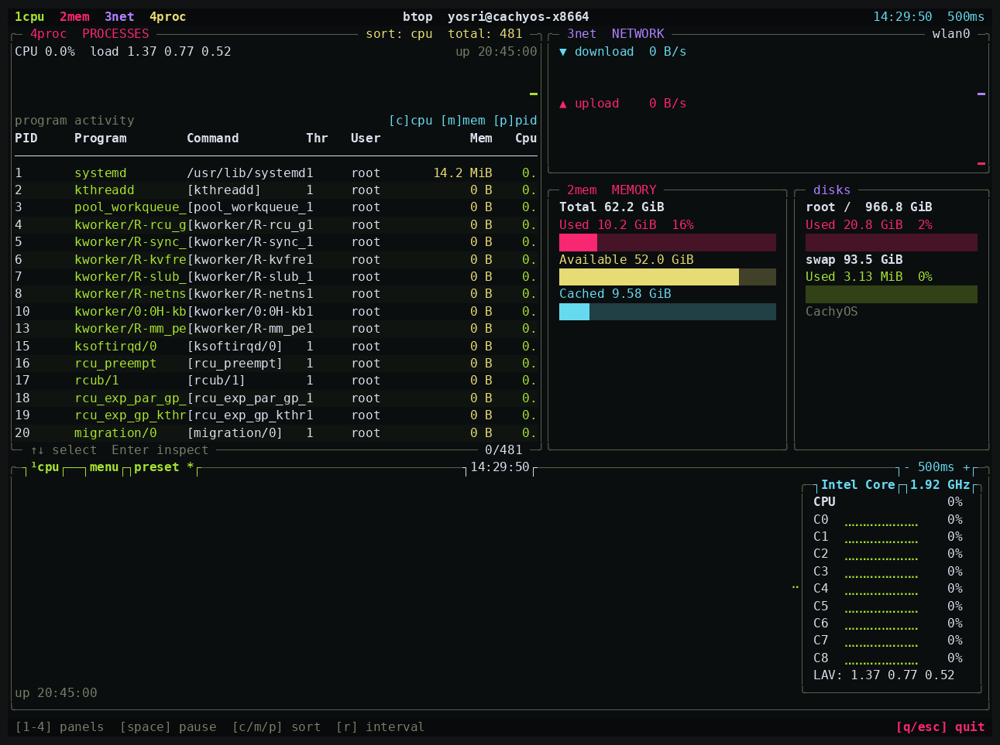
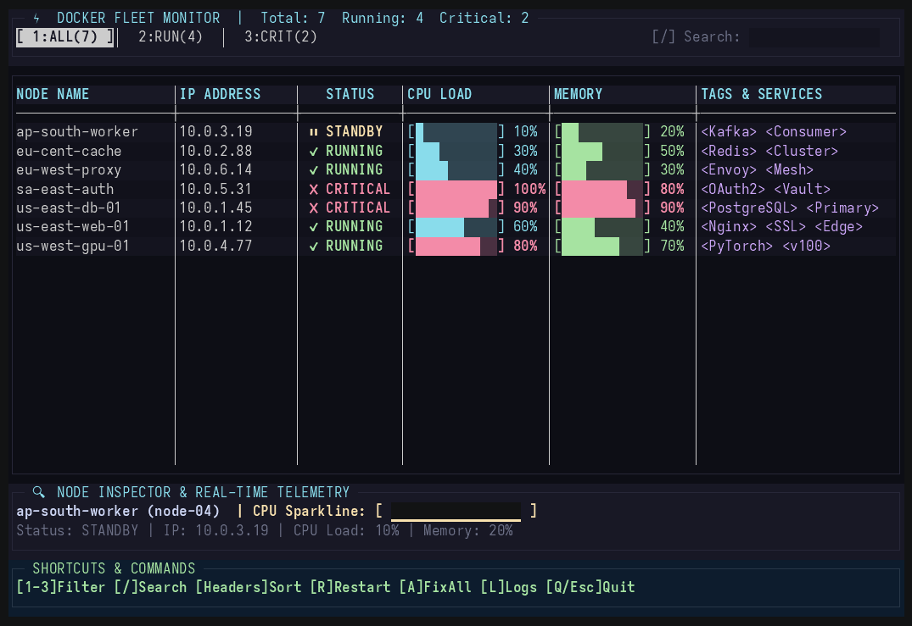
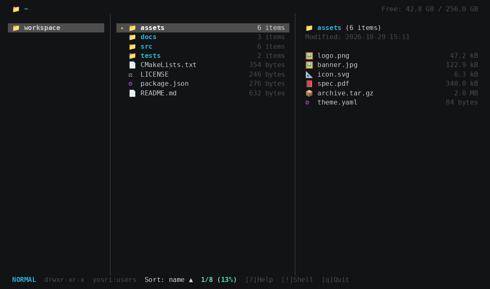
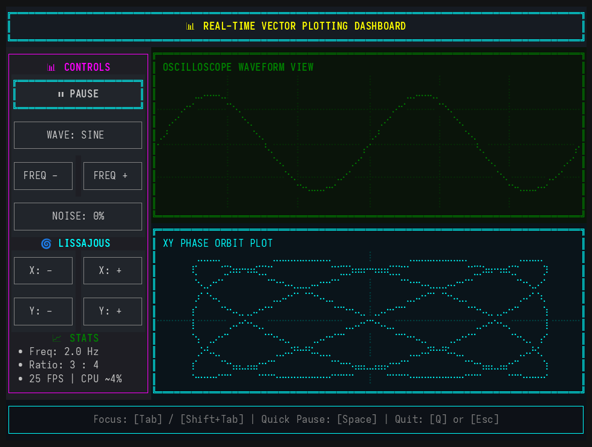

# QmlTui applications

The larger QmlTui showcase applications live here (`qmltui/apps`). The core framework repository ([`qmltui/qmltui`](https://github.com/qmltui/qmltui)) keeps the library, component gallery, focused recipes, and Markdown documentation; the documentation portal and WebAssembly playground live in [`qmltui/website`](https://github.com/qmltui/website).

Requires C++20, Qt 6.8+ with QmlPrivate, and CMake 3.21+. Private Qt features
(Behavior and StateGroup) are enabled; PtyView is enabled on Unix. Optional
applications also use Qt Multimedia or Network. The Markdown viewer downloads
md4qt during configuration.

```sh
cmake -S . -B build -G Ninja -DFETCHCONTENT_SOURCE_DIR_QMLTUI=/home/yosri/qmltui
cmake --build build -j 6
ctest --test-dir build -LE Demo --output-on-failure
```

To record `.cast` and `.gif` showcase previews into `docs/assets/casts/` (requires [`agg`](https://github.com/asciinema/agg) in `PATH` or `~/.cargo/bin` for GIF conversion):

```sh
ctest --test-dir build -L Demo --output-on-failure
```

Without the source override, FetchContent uses `qmltui/qmltui` tag `main`.
The release CI job is gated by `QMLTUI_RELEASE_AVAILABLE` until that tag is public.
Use `-DQMLTUI_BUILD_MARKDOWN_VIEWER=OFF` to configure without downloading md4qt.

## Applications

### [agent_stream](apps/agent_stream/)

Interactive coding-agent session combining `Terminal.Inline`, `Scrollback`, slash-command autocomplete, model selector, side-by-side diff inspector, permission prompts, and streaming tool cards.


### [audio_player](apps/audio_player/)

Retained-mode terminal audio player and real-time 24-band FFT spectrum / Braille stereo oscilloscope visualizer with docked studio decks, playlist editor, ANSI skins, and a procedural synthwave album.


### [btop](apps/btop/)

System resource monitor with Braille CPU history graphs, per-core meters, memory and disk bars, network throughput sparklines, sortable process table, and `Behavior`-animated panel collapsing.



### [container_fleet](apps/container_fleet/)

Docker container fleet dashboard featuring `TableView` column sorting, status filter tabs, live search, per-node CPU sparklines, and a streaming container log drawer.



### [file_manager](apps/file_manager/)

Three-column Miller file manager with syntax-highlighted source and Markdown previews, asynchronous image/SVG/multi-page PDF rendering (`Auto`, `HalfBlock`, `Braille`, `ASCII`), live filtering, and an integrated `PtyView` shell drawer.



### [industrial_plc_hmi](apps/industrial_plc_hmi/)

Industrial PLC controller and SCADA HMI operator console with telemetry gauges, Braille temperature trend chart, actuator LEDs, alarm history, hardware diagnostics, safety threshold settings, and blinking fault interlocks.


### [markdown_viewer](apps/markdown_viewer/)

Terminal Markdown document viewer powered by KDE's `md4qt` AST parser with syntax-highlighted code blocks, Unicode box tables, heading navigation, live style editor, search highlighting, and color themes.


### [package_manager](apps/package_manager/)

Inline CLI package installer simulation (`qpm`) combining `Terminal.Inline` live progress bars and spinners with committed `Scrollback` build logs.


### [plotting_dashboard](apps/plotting_dashboard/)

Real-time vector plotting dashboard with high-resolution Braille `Canvas` oscilloscope waveforms (sine, square, triangle, sawtooth), frequency and noise modulation, and XY Lissajous phase orbits.



### [screensaver](apps/screensaver/)

Retro demoscene screensaver collection featuring 11 rendering modes (`Canvas.HalfBlock`, `Canvas.Braille`, Unicode box-drawing 3D pipes, ASCII raymarched donut, Conway's Game of Life, Doom Fire, 3D Tesseract, Lorenz Attractor) and color themes.


### [snake_game](apps/snake_game/)

Classic arcade Snake rendered with half-block subpixel graphics (`Canvas.HalfBlock`), dynamic speed levels, pause overlay, and responsive viewport handling.


### [twozero48](apps/twozero48/)

2048 sliding-tile puzzle game with authentic tile color palettes, `Behavior` color transitions, score tracking, and win/game-over overlays.


