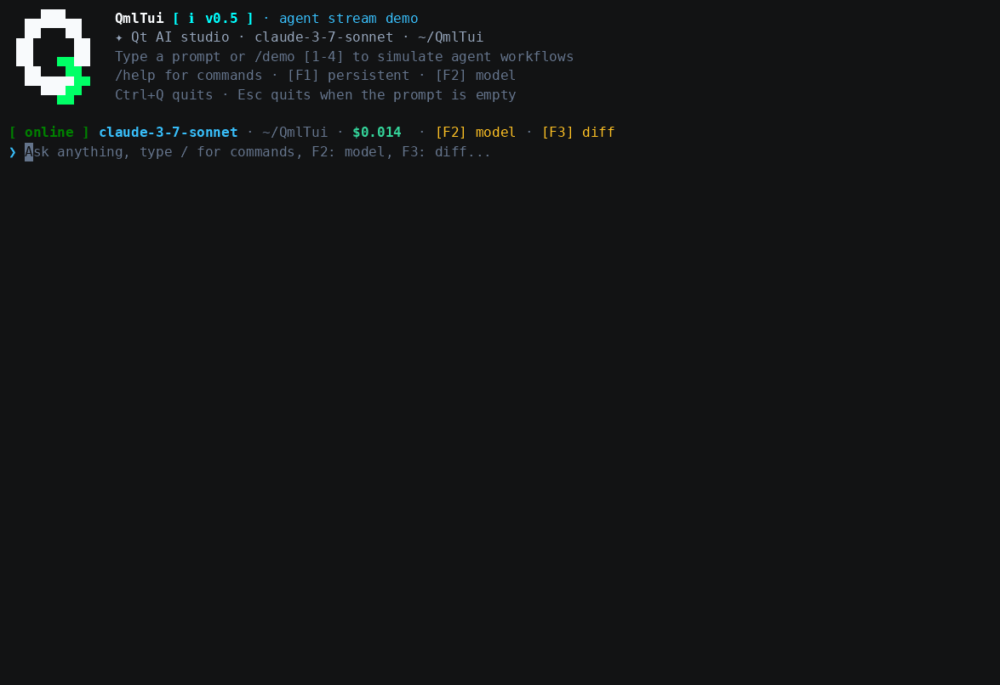
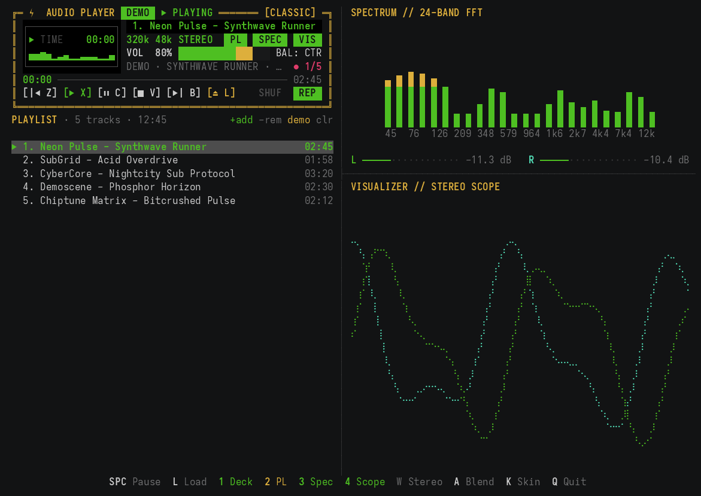
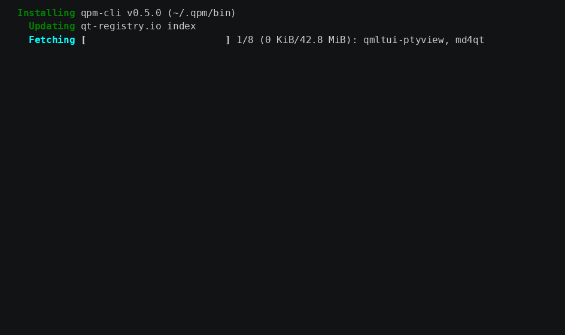
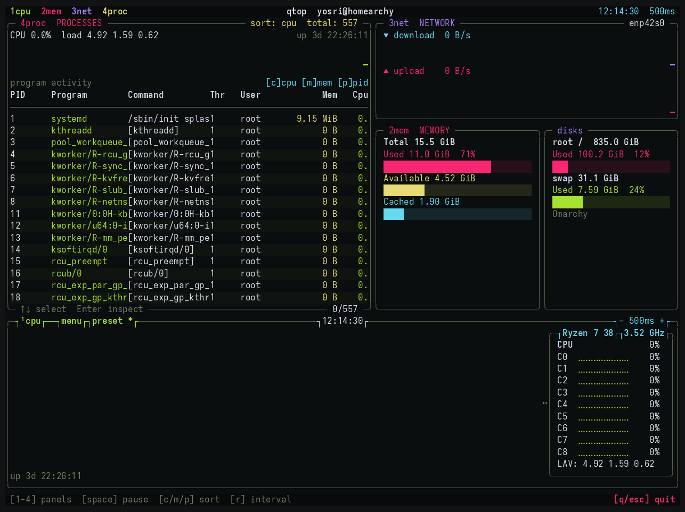

# QmlTui Applications

Full-scale showcase applications built with [QmlTui](https://github.com/qmltui/qmltui). Core libraries, component examples, recipes, and reference documentation live in [`qmltui/qmltui`](https://github.com/qmltui/qmltui); the documentation portal and WebAssembly playground live in [`qmltui/website`](https://github.com/qmltui/website).

## Build and Test

Requires CMake 3.21+, a C++20 compiler, and Qt 6.8+ (`Core`, `Qml`, and `QmlPrivate` for `Behavior`-enabled apps; `PtyView` requires Linux or macOS; optional features use `Gui`, `Svg`, `Pdf`, `Multimedia`, or `Network`).

```sh
cmake -S . -B build -G Ninja
cmake --build build
ctest --test-dir build -LE Demo --output-on-failure
```

To build and launch a single application:

```sh
cmake --build build --target qmltui_qtop
./build/apps/qtop/qmltui_qtop
```

Useful CMake options:

- `-DFETCHCONTENT_SOURCE_DIR_QMLTUI=/path/to/qmltui`: build against a local QmlTui checkout instead of fetching `main`.
- `-DQMLTUI_BUILD_MARKDOWN_VIEWER=OFF`: skip fetching KDE `md4qt` at configure time.
- `ctest --test-dir build -L Demo --output-on-failure`: record `.cast` and `.gif` previews into `docs/assets/casts/` (requires [`agg`](https://github.com/asciinema/agg) in `PATH` or `~/.cargo/bin` for GIF conversion).

## Applications

### [agent_stream](apps/agent_stream/)

Interactive coding-agent session using `Terminal.Inline`, `Scrollback`, slash-command autocomplete, side-by-side diff inspection, and streaming tool cards.



### [audio_player](apps/audio_player/)

Winamp-inspired terminal audio player with a 24-band FFT spectrum analyzer, Braille stereo oscilloscope, playlist editor, ANSI skins, and a procedural synthwave album.



### [container_fleet](apps/container_fleet/)

Container fleet dashboard with `TableView` column sorting, status filter tabs, live search, CPU sparklines, and a streaming log drawer.


### [file_manager](apps/file_manager/)

Three-column Miller file manager with syntax-highlighted text previews, asynchronous image/SVG/PDF rendering, live filtering, and an embedded `PtyView` shell drawer.


### [industrial_plc_hmi](apps/industrial_plc_hmi/)

ISA-101 SCADA operator console and PLC simulator with thresholded gauges, multi-trace Braille trend scope, animated P&ID reactor mimic, safety interlock popups, audit log, and I/O diagnostics.


### [markdown_viewer](apps/markdown_viewer/)

Terminal Markdown reader powered by KDE `md4qt` with syntax-highlighted code blocks, Unicode box tables, heading navigation, search highlights, and live style editing.


### [package_manager](apps/package_manager/)

Multi-stage `Terminal.Inline` package installer (`qpm`) with an interactive transaction `TableView`, dependency `TreeView`, parallel build progress, and `Scrollback` summary cards.



### [plotting_dashboard](apps/plotting_dashboard/)

Real-time vector plotting dashboard with Braille `Canvas` waveforms (sine, square, triangle, sawtooth), frequency/noise modulation, and XY Lissajous orbits.


### [qtop](apps/qtop/)

[`btop++`](https://github.com/aristocratos/btop)-inspired system monitor layout study with Braille CPU graphs, per-core meters, network sparklines, sortable process table, and `Behavior`-animated panels in ~770 lines of QML.



### [screensaver](apps/screensaver/)

Collection of 11 classic screensavers across `Canvas.HalfBlock`, `Canvas.Braille`, Unicode box-drawing 3D pipes, ASCII raymarching, and cellular automata.


### [snake_game](apps/snake_game/)

Arcade Snake game rendered with `Canvas.HalfBlock` subpixels, dynamic speed levels, pause overlay, and responsive viewport sizing.


### [twozero48](apps/twozero48/)

2048 sliding-tile puzzle with tile color palettes, `Behavior` color transitions, score tracking, and win/game-over overlays.


