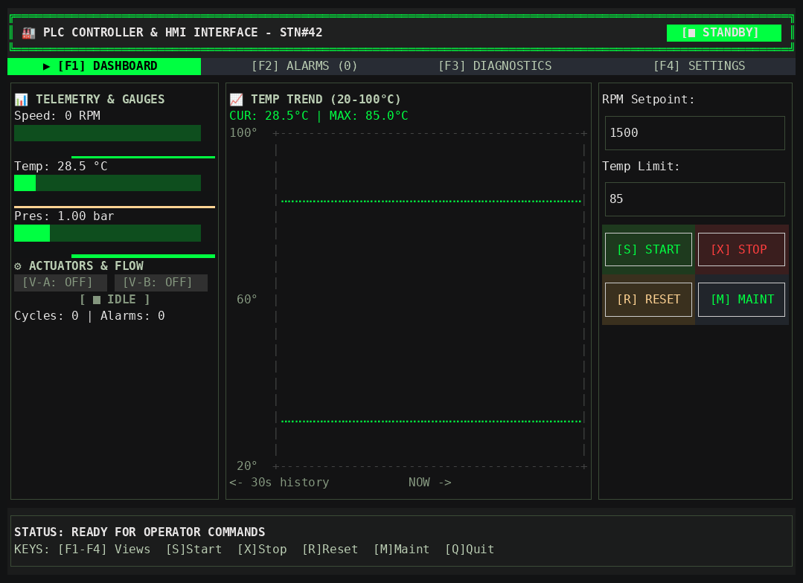
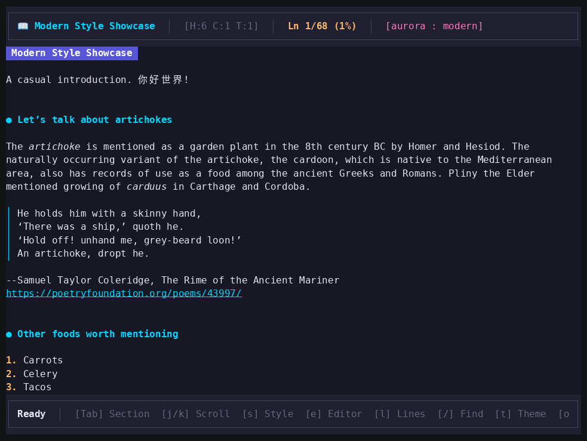
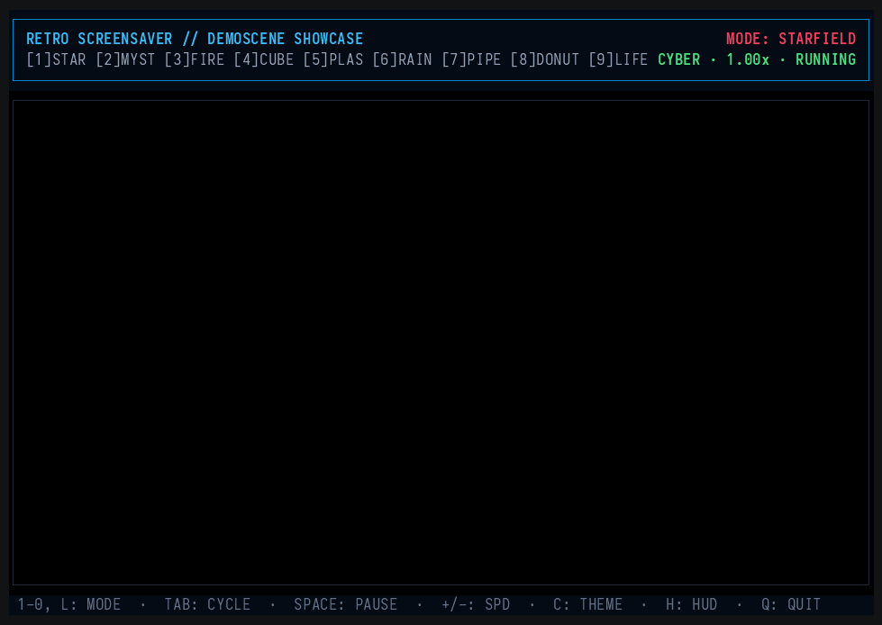
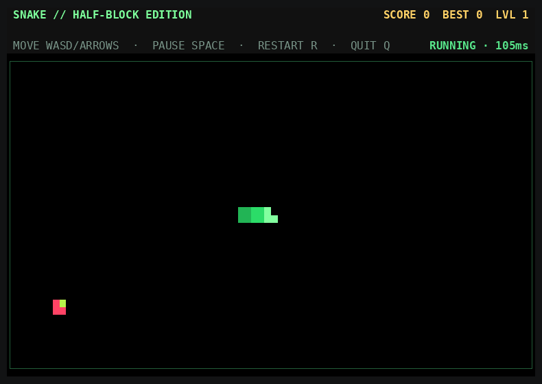
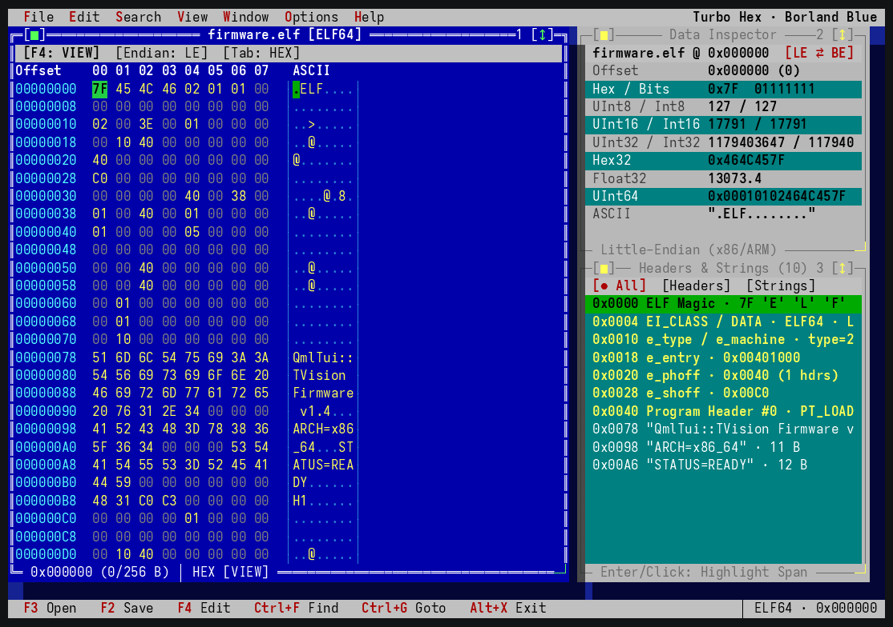
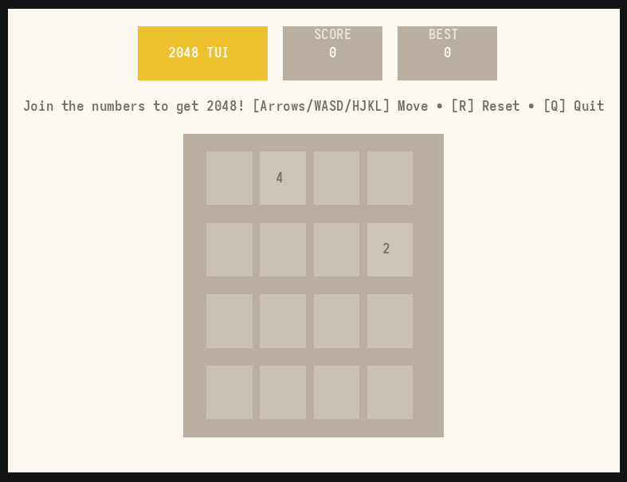

# QmlTui Applications

Full-scale showcase applications built with [QmlTui](https://github.com/qmltui/qmltui). Browse the rendered [Application Showcase](https://qmltui.github.io/showcase.html), read the [Documentation Portal](https://qmltui.github.io/), or try the [Live WebAssembly Playground](https://qmltui.github.io/playground.html) (site source in [`qmltui/qmltui.github.io`](https://github.com/qmltui/qmltui.github.io)). Core libraries, component examples, recipes, and reference documentation live in [`qmltui/qmltui`](https://github.com/qmltui/qmltui).

## Build and Test

Requires CMake 3.21+, a C++17 compiler, and Qt 6.8+ (`Core`, `Qml`, and `QmlPrivate` for `Behavior`-enabled apps; `PtyView` requires Linux or macOS; optional features use `Gui`, `Svg`, `Pdf`, `Multimedia`, or `Network`).

```sh
cmake -S . -B build -G Ninja
cmake --build build
ctest --test-dir build -LE Demo --output-on-failure
```

To build and launch a single application:

```sh
cmake --build build --target qmltui_qtop
./build/apps/qtop/qmltui_qtop
```

Useful CMake options:

- `-DFETCHCONTENT_SOURCE_DIR_QMLTUI=/path/to/qmltui`: build against a local QmlTui checkout instead of fetching `main`.
- `-DFETCHCONTENT_SOURCE_DIR_QMLTUI_MARKDOWN=/path/to/markdown`: build against a local `QmlTui.Markdown` checkout (a sibling `../markdown` directory is auto-detected when present).
- `-DFETCHCONTENT_SOURCE_DIR_QMLTUI_CHARTS=/path/to/charts`: build against a local `QmlTui.Charts` checkout (a sibling `../charts` directory is auto-detected when present).
- `-DFETCHCONTENT_SOURCE_DIR_QMLTUI_TVISION=/path/to/tvision`: build `turbo_hex` against a local `QmlTui.TVision` checkout (a sibling `../tvision` directory is auto-detected when present).
- `-DFETCHCONTENT_SOURCE_DIR_QMLTUI_PTYVIEW=/path/to/ptyview`: build `file_manager` against a local `QmlTui.PtyView` checkout (a sibling `../ptyview` directory is auto-detected when present on Linux and macOS).
- `-DQMLTUI_BUILD_MARKDOWN_VIEWER=OFF`: skip building the `markdown_viewer` showcase target.
- `-DQMLTUI_BUILD_TURBO_HEX=OFF`: skip fetching `QmlTui.TVision` at configure time.
- `ctest --test-dir build -L Demo --output-on-failure`: record `.cast` and `.gif` previews into `docs/assets/casts/` (requires [`agg`](https://github.com/asciinema/agg) in `PATH` or `~/.cargo/bin` for GIF conversion).

## Applications

### [agent_stream](apps/agent_stream/)

Interactive coding-agent session using `Terminal.Inline`, `Scrollback`, [`QmlTui.Markdown`](https://github.com/qmltui/markdown) (`MdBlock`) streaming responses, slash-command autocomplete, side-by-side diff inspection, and streaming tool cards.


### [audio_player](apps/audio_player/)

Winamp-inspired terminal audio player with a 24-band FFT spectrum analyzer, Braille stereo oscilloscope, playlist editor, ANSI skins, and a procedural synthwave album.


### [container_fleet](apps/container_fleet/)

Container fleet dashboard with `TableView` column sorting, status filter tabs, live search, CPU sparklines, and a streaming log drawer.


### [file_manager](apps/file_manager/)

Three-column Miller file manager with [`QmlTui.Markdown`](https://github.com/qmltui/markdown) previews (`MdView` for Markdown files and `SyntaxHighlighter` for source code), asynchronous image/SVG/PDF rendering, live filtering, and an embedded [`QmlTui.PtyView`](https://github.com/qmltui/ptyview) shell drawer.


### [industrial_plc_hmi](apps/industrial_plc_hmi/)

ISA-101 SCADA operator console and PLC simulator using [`QmlTui.Charts`](https://github.com/qmltui/charts) (`Gauge` thresholded telemetry bars and a dual-Y `ChartView` trend scope with `ReferenceLine`), animated P&ID reactor mimic, safety interlock popups, audit log, and I/O diagnostics.



### [markdown_viewer](apps/markdown_viewer/)

Terminal Markdown reader built on [`QmlTui.Markdown`](https://github.com/qmltui/markdown) (powered by KDE `md4qt`) with syntax-highlighted code blocks, Unicode box tables, heading navigation, OSC 8 hyperlinks, search highlights, and live style editing.



### [package_manager](apps/package_manager/)

Multi-stage `Terminal.Inline` package installer (`qpm`) with an interactive transaction `TableView`, dependency `TreeView`, parallel build progress, and `Scrollback` summary cards.


### [plotting_dashboard](apps/plotting_dashboard/)

Real-time vector plotting dashboard built on [`QmlTui.Charts`](https://github.com/qmltui/charts) (`ChartView` with interactive crosshair inspection, `ValueAxis`, `ReferenceLine`, and Braille `LineSeries`) for waveforms (sine, square, triangle, sawtooth), frequency/noise modulation, and closed XY Lissajous orbits.


### [qtop](apps/qtop/)

[`btop++`](https://github.com/aristocratos/btop)-inspired system monitor layout study with Braille CPU graphs, per-core meters, network sparklines, sortable process table, and `Behavior`-animated panels in ~770 lines of QML.


### [screensaver](apps/screensaver/)

Collection of 11 classic screensavers across `Canvas.HalfBlock`, `Canvas.Braille`, Unicode box-drawing 3D pipes, ASCII raymarching, and cellular automata.



### [snake_game](apps/snake_game/)

Arcade Snake game rendered with `Canvas.HalfBlock` subpixels, dynamic speed levels, pause overlay, and responsive viewport sizing.



### [turbo_hex](apps/turbo_hex/)

IDA `idat`- and Borland Turbo Debugger-inspired **Multi-Window Hex & Binary Inspector** built on [`QmlTui.TVision`](https://github.com/qmltui/tvision), featuring synchronized Hex + ASCII windows, a live Little/Big-Endian Data Inspector, ELF/PNG/ZIP/WASM header & string span highlighting, hex/text search, in-place byte patching, and switchable BIOS palettes.



### [twozero48](apps/twozero48/)

2048 sliding-tile puzzle with tile color palettes, `Behavior` color transitions, score tracking, and win/game-over overlays.


